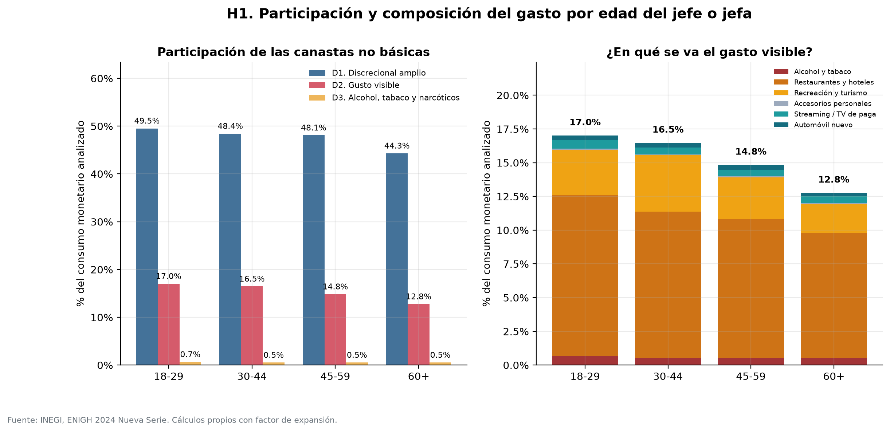
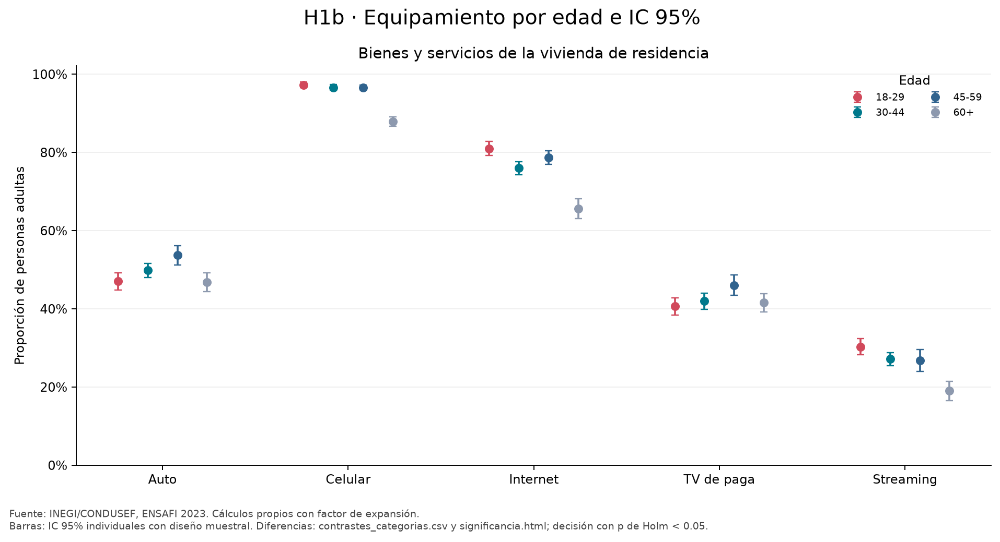
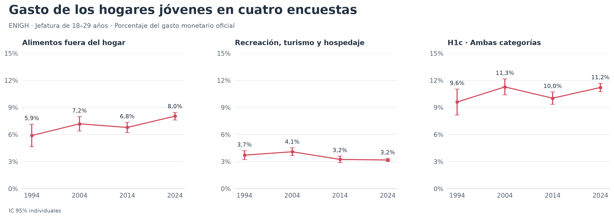
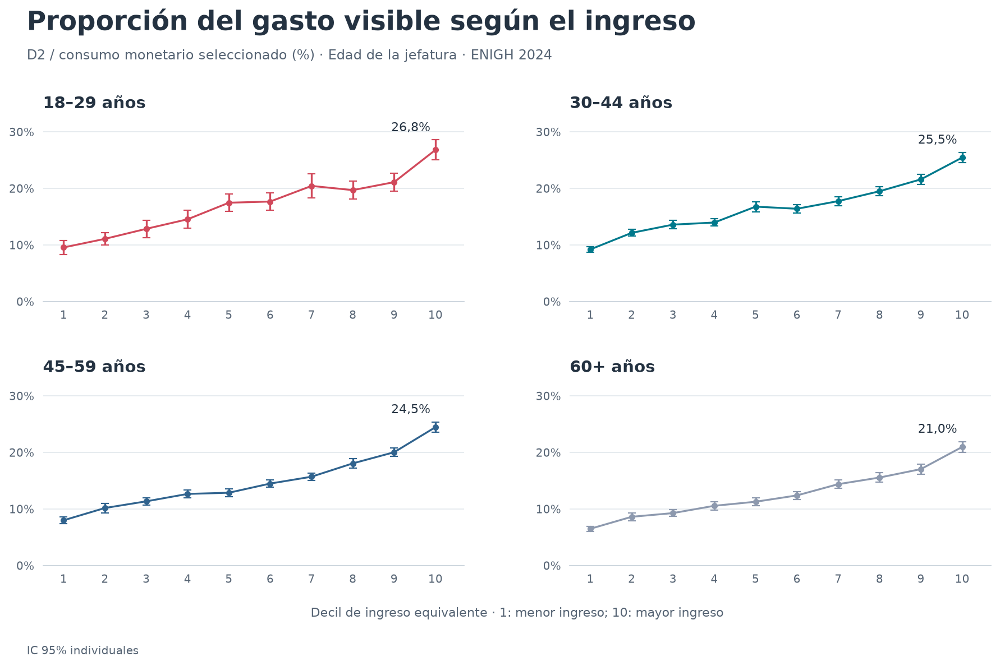
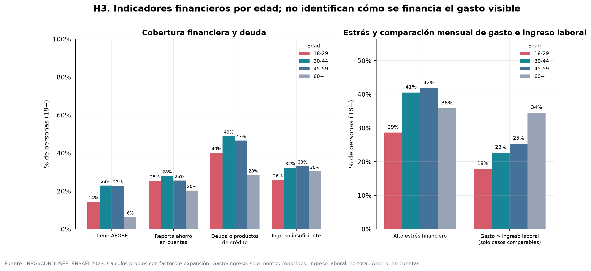
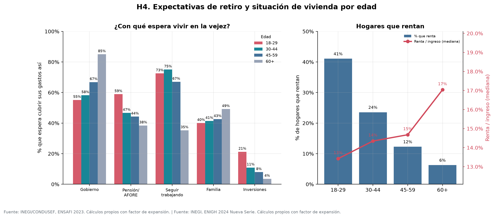
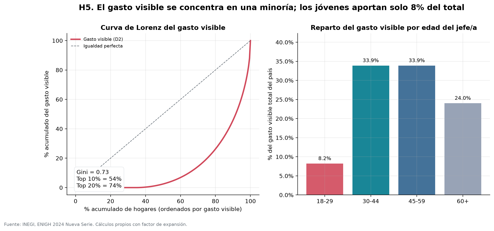

# Gente pobre de gustos caros

## *tl;dr*

He oído muchas veces que los jóvenes gastan una cantidad enorme de dinero en lujos innecesarios y luego se quejan de la falta de pensiones dignas, vivienda y otras desventuras. El argumento suele usarse para desestimar esos problemas y reducirlos a un asunto de administración personal.

Este proyecto contrasta esa idea con microdatos de México. Los hogares cuyo jefe o jefa tiene entre 18 y 29 años destinan **17.0%** de su consumo monetario analizado a la canasta de gasto visible D2, frente a **12.8%** en hogares de 60 años o más: una diferencia de **4.25 puntos porcentuales**. Restaurantes y hoteles explica la mayor parte de esa diferencia.

**Comparación histórica a la misma edad:** la canasta H1c —alimentos fuera del hogar más recreación, turismo y hospedaje— representa **9.60%, 11.27%, 10.02% y 11.21%** del gasto monetario de los hogares jóvenes en 1994, 2004, 2014 y 2024. La diferencia de 2024 frente a 2004 es **−0.06 p.p. (IC 95%: −1.05 a +0.93)**. Esta comparación no muestra un aumento continuo ni identifica preferencias generacionales; H1c tiene una definición distinta de D2.

El gasto visible está concentrado: el 10% de hogares que más gasta en D2 concentra **48.0%** del monto total, y el 20% concentra **66.2%**. Los hogares jóvenes representan 7.4% de los hogares analizados y 7.8% del gasto visible. Estas cifras no demuestran que ese consumo cause dificultades de vivienda o retiro.

> **Revisión del 23 de octubre de 2026:** se corrigieron cruces de identificadores, gastos personales omitidos, equivalencia del hogar, periodicidad del ingreso y otros cálculos. Las cifras de la primera publicación fueron sustituidas. El [informe de revisión](reports/revision_metodologica.md) documenta los errores, decisiones y resultados antes y después.

## Resultado por hipótesis

| Hipótesis | Resultado descriptivo | Qué permite afirmar |
|---|---|---|
| **H1.** En 2024, los hogares con jefatura joven destinan una mayor proporción a D2 que los de mayor edad. | D2: 17.0% vs. 12.8% en 60+; D1: 49.5% vs. 44.3%. | Hay diferencias por edad bajo las canastas elegidas; no todo gasto seleccionado es prescindible. |
| **H1c.** A igual edad de jefatura (18–29), la proporción en alimentos fuera y recreación, turismo y hospedaje es mayor en 2024 que en las olas anteriores. | 9.60% en 1994; 11.27% en 2004; 10.02% en 2014; 11.21% en 2024. | Diferencias positivas respecto de 1994 y 2014; el IC del contraste con 2004 incluye cero. No sostiene un aumento frente a todas las épocas. |
| **H2.** La diferencia persiste entre hogares de ingreso similar. | D2 en 2024: brecha joven − 60+ de 2.46–6.19 p.p. H1c: brecha positiva en los diez deciles de cada año, 1994–2024. | La extensión histórica usa ingreso por persona; describe un patrón por edad e ingreso, sin ajuste conjunto por otros factores. |
| **H3.** Ese gasto se financia con deuda o desahorro. | **Financiamiento específico no identificado.** Préstamos recibidos en hogares jóvenes: 6.46%, 9.59%, 7.86%, 3.76% en 1994–2024. | ENIGH observa gasto y flujos financieros en el mismo hogar; no asigna esos recursos a compras específicas ni mide desahorro neto con el solo retiro. |
| **H4.** Hay desventajas de vivienda y pensión y las quejas son infundadas. | Vivienda propia entre hogares jóvenes principales: 45.56% en 1994 y 32.94% en 2024; rentada: 30.50% y 42.20%. | Se observa cambio histórico de tenencia. Pensiones recibidas, expectativas y suficiencia son medidas distintas; no se evalúan quejas ni causalidad. |
| **H5.** El gasto visible se concentra en una minoría. | D2 en 2024: top 10% concentra 48.0%. En H1c histórico: 67.49% en 1994 y 52.47% en 2024. | La canasta histórica conserva alta concentración, menor en 2024. H1c y D2 no son intercambiables; el ranking es por gasto. |

No hay una estimación causal de cuánto explican los hábitos de consumo de la situación de vivienda o retiro. Tampoco basta una brecha de gasto para atribuir esos problemas a decisiones personales.

## Comparación histórica de todas las hipótesis

La [galería H1–H5](reports/historico_hipotesis.md) reúne **ocho gráficas y diez tablas CSV**
de ENIGH 1994, 2004, 2014 y 2024, con [informe completo](reports/historico_hipotesis.html).

| Extensión | Resultado histórico | Alcance |
|---|---|---|
| H1 y H2: gasto por edad e ingreso | H1c joven: 9.60%, 11.27%, 10.02%, 11.21%. La brecha joven − 60+ es positiva en los diez deciles de cada año. | H1c e ingreso por persona; los IC de la brecha excluyen cero en 8/10 deciles de cada ola antigua y 10/10 de 2024. |
| H1b: equipamiento, 2004–2024 | Internet en hogares jóvenes: 3.91% → 69.44%; automóvil: 20.40% → 27.10%. | Hogares ENIGH; disponibilidad, sin precio ni antigüedad. |
| H3: préstamos y retiros | Jóvenes que reciben préstamos no hipotecarios: 6.46%, 9.59%, 7.86%, 3.76%. | Se observa el gasto y los flujos en el mismo hogar; no el financiamiento de cada compra ni el desahorro neto. |
| H4: vivienda | Propiedad entre hogares jóvenes principales: 45.56% → 32.94%; renta: 30.50% → 42.20%. | Mismo universo de hogares principales; no mide por sí solo asequibilidad o emancipación. |
| H4: recepción de pensiones | Hogares con jefatura de 60+ e ingreso por pensión de algún integrante: 22.65% → 42.52%. | Recepción actual; no expectativas ni suficiencia futura. Los programas para adultos mayores se muestran aparte. |
| H5: concentración | El 10% que más gasta en H1c concentra 67.49% → 52.47%; Gini: 0.817 → 0.714. | Ranking por gasto, con ceros incluidos e intervalos por bootstrap de UPM. |

Las extensiones históricas usan definiciones explícitas y conservan los resultados originales
de D2 y ENSAFI. Los intervalos son individuales y las comparaciones son descriptivas;
mantener la edad no separa cohorte y periodo.

## Fuentes y universo

| Fuente | Año | Universo analizado | Ponderador |
|---|---|---|---|
| ENIGH histórica, INEGI | 1994, 2004, 2014 | 12,508; 22,565; 19,463 hogares con jefatura adulta, respectivamente | `HOG` / `factor_hog` |
| ENIGH Nueva Serie, INEGI | 2024 | 91,380 hogares con jefatura de 18 años o más, de 91,414 en la fuente | `factor` |
| ENSAFI, INEGI/CONDUSEF | 2023 | 20,448 personas de 18 años o más | `FAC_ELE` |

- ENIGH aporta ingreso, consumo, composición familiar y vivienda. Se integran **gastoshogar y gastospersona** por hogar.
- ENSAFI aporta tenencia de cuentas y productos de crédito, estrés, gasto e ingreso laboral declarados y expectativas de retiro.
- Se excluyen 34 hogares ENIGH con jefatura menor de 18 de todos los perfiles, deciles y medidas nacionales.
- Grupos de edad: **18–29, 30–44, 45–59 y 60+**. La edad del jefe representa al hogar ENIGH, no a cada consumidor.
- El alcance geográfico es México. Las fuentes no se unen entre sí y no constituyen un panel.

## Metodología

### Canastas de gasto

Se selecciona consumo monetario para el propio hogar: tipo G1 de las dos tablas de gastos. Se excluyen capítulo 17 y regalos T9. Las participaciones se calculan sobre ese consumo seleccionado, no sobre todo el ingreso ni directamente sobre `gasto_mon`.

| Canasta | Definición operativa | Capítulos o claves |
|---|---|---|
| **D1. Discrecional amplio** | Canasta amplia de sensibilidad; incluye gastos que pueden ser necesarios. | 02, 05, 07, 08, 09, 11, 12 y 13 |
| **D2. Gasto visible** | Aproximación a recreación, salidas, accesorios seleccionados, servicios digitales y automóvil nuevo. | 02, 09 y 11; accesorios `132111`, `132112`, `132911`, `132912`, `132913`, `132915`; digital `081404`, `083921`–`083924`; auto nuevo `071110` |
| **D3. Alcohol, tabaco y narcóticos** | Canasta restringida del capítulo 02. | 02 |

D2 no incluye automáticamente todos los bolsos, efectos personales o artículos de los prefijos 1321 y 1329. Se excluyen de esa canasta artículos funerarios, para bebé, mochilas y otros objetos no listados. La sección digital también incluye equipos de transmisión y ciertos alquileres de soportes o software. La [taxonomía](src/gpdgc/taxonomy.py) contiene la selección exacta; el [informe](reports/revision_metodologica.md) explica sus límites. Visible, costoso y prescindible no son equivalentes.

### Ponderación y composición familiar

- Se usan factores de expansión. Las participaciones por edad son **medias ponderadas de las proporciones de cada hogar**, no cocientes entre sumas nacionales.
- La escala OCDE modificada es `1 + 0.5 × (personas de 14 o más − 1) + 0.3 × menores de 14`. El conteo se construye desde población, excluyendo trabajadores domésticos, sus familiares y huéspedes, como en `tot_integ`.
- Ingreso y gasto equivalentes se obtienen dividiendo por esa escala. Los montos ENIGH son trimestrales.
- Los deciles se calculan en el universo de jefaturas adultas, con ingreso corriente equivalente y ponderadores de hogar. Los empates permanecen juntos y pueden dejar grupos vacíos.
- Los cuantiles usan la inversa de la distribución empírica ponderada, sin interpolación. El top de gasto incluye solo la fracción del peso del registro que alcanza el corte.
- Los hogares con consumo seleccionado cero permanecen en niveles y concentración; quedan fuera de medias de participaciones por tener denominador cero.

### Comparación histórica H1c

H1c conserva dos categorías amplias: alimentos fuera del hogar y recreación, turismo y hospedaje. Su denominador es el gasto corriente monetario oficial. Incluye los componentes monetarios de registros mixtos, siguiendo las construcciones de INEGI. A diferencia del capítulo 11 usado en D2, alimentos fuera excluye las claves de comida preparada para consumir en casa. Las claves, diferencias frente a D2 y lecturas de los PDF están en el [informe histórico](reports/h1_historico.md).

Se comparan 1994, 2004, 2014 y 2024 con ponderadores de hogar, errores estándar e IC 95% calculados con estratos y UPM. Se publican sensibilidades que fijan la distribución de edades simples de 2024, comparan quintiles de ingreso por persona y excluyen transferencias según la definición de cada ola. Son cortes transversales repetidos: mantener la edad no separa cohorte y periodo.

### Indicadores financieros ENSAFI

`P5_19` no es necesariamente mensual. Se utiliza **INGRESO_M**, ingreso mensual **por trabajo**, y se compara con el gasto mensual `P5_21`. Se excluyen montos desconocidos o abiertos de 98,000 y más. Los ceros conocidos se conservan.

El indicador **gasto mayor al ingreso laboral mensual** usa solo casos comparables. No mide desahorro: una persona puede financiar su gasto con pensión, transferencias u otros ingresos no incluidos en el ingreso laboral. El CSV publica tanto el número de casos comparables como su cobertura ponderada.

“Deuda o productos de crédito” combina P6.5 y P6.6: tener tarjeta de crédito no demuestra un saldo pendiente. “Reporta ahorro en cuentas” no incluye ahorro informal. “Reporta atraso” es incidencia sobre todos los adultos, no tasa entre deudores. Tener AFORE no prueba cotización activa ni pensión suficiente.

### Cruces y conciliación

Los identificadores se leen como texto para preservar ceros iniciales. El proceso valida cardinalidad, correspondencia de viviendas, integrantes del hogar y claves de gastos sin hogar. Los componentes de D2 deben sumar su total y debe cumplirse `0 <= D3 <= D2 <= D1 <= consumo`.

Hay **91,333 hogares** con registros de consumo seleccionado y **47 sin ellos** en el universo adulto. La mediana de consumo seleccionado / gasto monetario oficial es **99.76%**, entre hogares con `gasto_mon > 0`. Esa cercanía no implica igualdad de conceptos ni conciliación exacta registro por registro.

La renta es mensual y el ingreso ENIGH trimestral: se usa `renta × 3 / ing_cor`. En viviendas con varios hogares, la renta de la vivienda no equivale al pago individual del hogar; hay 214 hogares analizados en esa situación de renta. El cociente debe interpretarse como aproximación.

## Hallazgos

### H1. Composición del consumo por edad

| Grupo | D1 | D2 | D3 | D2 por adulto equivalente, MXN trimestrales |
|---|---:|---:|---:|---:|
| 18–29 | 49.5% | 17.0% | 0.66% | 5,959 |
| 30–44 | 48.4% | 16.5% | 0.53% | 5,527 |
| 45–59 | 48.1% | 14.8% | 0.53% | 4,580 |
| 60+ | 44.3% | 12.8% | 0.53% | 3,681 |

La brecha joven − 60+ es **4.25 p.p. en D2** y **5.22 p.p. en D1**. D3 presenta una diferencia de 0.13 p.p.; no se ha realizado una prueba de significancia.

En jóvenes, D2 se compone de restaurantes y hoteles (11.94 p.p.), recreación (3.33), alcohol/tabaco (0.66), accesorios seleccionados (0.11), agrupación digital (0.64) y auto nuevo (0.34). Restaurantes puede incluir comidas necesarias por trabajo. Estos resultados no identifican una preferencia generacional por el lujo.

### H1b. Bienes y servicios de la vivienda

El 47.0% de las personas de 18–29 vive en una vivienda con automóvil, frente al 53.7% de quienes tienen 45–59 años. Internet alcanza 81.0% entre jóvenes y 65.6% entre mayores de 60; streaming, 30.3% y 19.0%, respectivamente.

Son características de la vivienda de residencia, no prueba de propiedad personal, de quién pagó el bien ni de que el automóvil sea nuevo.

**Comparación ENIGH 2004–2024:** entre hogares con jefatura de 18–29, celular pasa de **40.43% a 97.67%**, internet de **3.91% a 69.44%** y automóvil de **20.40% a 27.10%**. Televisión de paga alcanza 31.28% en 2014 y baja a 26.22% en 2024. Estas proporciones usan hogares ENIGH; las anteriores de ENSAFI usan personas residentes y no son directamente equivalentes.

### H1c. Comparación histórica a la misma edad

| Año | Alimentos fuera | Recreación, turismo y hospedaje | H1c | IC 95% de H1c | n joven válido |
|---|---:|---:|---:|---:|---:|
| 1994 | 5.88% | 3.71% | 9.60% | 8.17–11.03% | 2,012 |
| 2004 | 7.18% | 4.09% | 11.27% | 10.39–12.15% | 2,780 |
| 2014 | 6.78% | 3.24% | 10.02% | 9.34–10.70% | 2,103 |
| 2024 | 8.03% | 3.18% | 11.21% | 10.74–11.67% | 7,220 |

En 2024, H1c supera a 1994 en **1.61 p.p.** (IC 95%: 0.11–3.11) y a 2014 en **1.19 p.p.** (0.36–2.01). Frente a 2004, la diferencia es **−0.06 p.p.** (−1.05–0.93). Los IC son individuales, sin ajuste por comparaciones múltiples. Fijando las edades simples en la mezcla de 2024, la diferencia con 2004 queda en **+0.09 p.p.** (IC condicional: −0.90–1.08).

El aumento frente a 1994 proviene de alimentos fuera (+2.15 p.p.); recreación, turismo y hospedaje disminuye 0.54 p.p. Son categorías amplias que incluyen comidas por trabajo, computadoras y hospedaje no turístico. La evidencia permite describir una composición distinta del gasto, sin atribuirla a una mayor preferencia generacional por el lujo.

El [informe H1c](reports/h1_historico.md) contiene las otras dos figuras —[edades](reports/figures/h1_historico_edades.png) e [ingreso](reports/figures/h1_historico_quintiles.png)—, los contrastes, el cambio en composición familiar, las correspondencias de categorías y las páginas clave de la documentación.

### H2. Diferencias dentro de los deciles

D2 es mayor en hogares de 18–29 que en los de 60+ en los diez deciles. La brecha mínima es **2.46 p.p. en el decil 2** y la máxima **6.19 p.p. en el decil 5**; no crece de forma monotónica con el ingreso.

En el decil 1, las participaciones son 9.6% y 6.5%; en el decil 10, 26.8% y 21.0%. Los montos equivalentes respectivos son $1,120 y $696 en el primer decil, y $21,706 y $13,862 en el décimo.

La persistencia dentro de deciles es descriptiva. No controla diferencias de empleo, urbanización, patrimonio, salud o composición familiar.

**Comparación histórica H2:** con H1c e ingreso por persona, la brecha joven − 60+ es positiva en los diez deciles de 1994, 2004, 2014 y 2024. Los IC 95% excluyen cero en 8/10 deciles de cada ola antigua y 10/10 de 2024. Son intervalos individuales, condicionales a cortes de ingreso estimados; los deciles representan posiciones relativas dentro de cada año.

### H3. Finanzas personales y alcance de la comparación

| Indicador | 18–29 | 30–44 | 45–59 | 60+ |
|---|---:|---:|---:|---:|
| Tiene AFORE | 14.4% | 22.9% | 22.7% | 6.3% |
| Deuda o productos de crédito | 40.1% | 48.8% | 46.6% | 28.4% |
| Reporta atraso, sobre todos los adultos | 10.1% | 12.3% | 11.4% | 4.8% |
| Alto estrés financiero | 28.6% | 40.5% | 41.8% | 35.8% |
| Gasto > ingreso laboral mensual, solo comparables | 17.8% | 22.7% | 25.3% | 34.5% |
| Cobertura ponderada de casos comparables | 64.0% | 76.0% | 68.7% | 38.3% |
| Número de casos comparables | 2,942 | 4,750 | 3,737 | 1,796 |
| Ingreso laboral mensual mediano, conocido y no topado | $6,450 | $7,740 | $6,880 | $4,800 |

Las primeras cuatro filas utilizan el universo adulto de cada edad. La comparación de gasto e ingreso usa **13,225 casos** en total y no es representativa de quienes carecen de información comparable sin supuestos adicionales. La mediana de ingreso usa su propio conjunto de respuestas válidas.

Los jóvenes reportan menor incidencia de crédito y estrés que los adultos de 30–44. Eso **no prueba ni refuta que su gasto visible se financie con deuda**. No se observa D2 y su financiamiento conjuntamente; tampoco puede interpretarse la comparación con ingreso laboral como tasa de ahorro.

**Comparación histórica H3:** ENIGH permite observar el gasto y las entradas financieras en los mismos hogares. Los jóvenes que reciben préstamos no hipotecarios representan **6.46%, 9.59%, 7.86% y 3.76%** en 1994, 2004, 2014 y 2024. Los que retiran ahorro o inversiones son **12.07%, 15.23%, 10.39% y 11.00%**. Se miden flujos declarados, no el saldo total de deuda ni el ahorro neto.

En 2024, H1c es **11.12%** entre hogares jóvenes con préstamo o retiro y **11.22%** entre los demás: diferencia **−0.10 p.p. (IC 95%: −1.18 a +0.98)**. Los intervalos de esta asociación incluyen cero en las cuatro olas; la comparación no ajusta ingreso o composición familiar ni identifica el destino de esos recursos.

### H4. Vivienda y expectativas de retiro

Renta el 41.1% de hogares jóvenes, frente a 23.6% de los de 30–44, 12.3% de los de 45–59 y 6.3% de los de 60+. La mediana de renta / ingreso entre rentadores es 13.4% entre jóvenes y 17.0% entre mayores.

En ENSAFI, espera recibir pensión, jubilación o AFORE el 58.9% de jóvenes y el 38.4% de mayores; espera apoyo de gobierno el 55.2% y el 85.0%; espera seguir trabajando el 72.5% y el 35.3%. Las respuestas no son excluyentes. Vivienda como meta —comprar/pagar o remodelar/mejorar— corresponde al 37.4% y al 21.5%.

La incidencia de renta y las expectativas son hechos descriptivos. No miden por sí solos deterioro generacional, capacidad de compra, dependencia efectiva del gobierno ni suficiencia futura de pensiones. La valoración de las quejas requiere un argumento adicional.

**Comparación histórica de vivienda:** entre hogares jóvenes principales, la vivienda propia, pagada o en pago, pasa de **45.56% en 1994 a 32.94% en 2024**; la rentada, de **30.50% a 42.20%**. Los cambios son **−12.62 p.p. (IC 95%: −18.56 a −6.68)** y **+11.70 p.p. (4.72 a 18.68)**. El universo se limita a hogares principales en los cuatro años porque las olas antiguas no registraban tenencia para los adicionales. La dirección se mantiene al fijar la mezcla de edades 18–29 de 2024.

**Recepción de ingresos para la vejez:** entre hogares con jefatura de 60+, alguno de sus integrantes recibe jubilación o pensión en **22.65%** de los casos en 1994 y **42.52%** en 2024. Los programas para adultos mayores se muestran aparte y pueden coexistir con una pensión. Esta medida no estima la pensión futura de los jóvenes ni su suficiencia.

### H5. Concentración del gasto visible

- **Gini D2:** 0.651.
- **Top 10% por gasto D2:** 48.0% del monto total.
- **Top 20%:** 66.2%.
- **Top 20% dentro de cada edad:** 63.0% en 18–29, 62.4% en 30–44, 65.8% en 45–59 y 71.1% en 60+.
- Los hogares jóvenes son 7.4% de los hogares analizados y aportan 7.8% de D2; los de 60+ son 31.9% y aportan 24.8%.

El gasto está concentrado en todos los grupos. No se deduce que quienes más gastan sean necesariamente los más ricos ni que los demás hogares estén libres de presión social para consumir.

**Comparación histórica H5:** el 10% que más gasta en H1c concentra **67.49%, 58.12%, 59.11% y 52.47%** en 1994, 2004, 2014 y 2024. El Gini es **0.817, 0.752, 0.761 y 0.714**. Incluye hogares con gasto cero; la concentración describe montos de la canasta H1c, distinta de D2. Los IC usan 399 réplicas de bootstrap reescalado por UPM dentro de estratos.

## Limitaciones

1. Análisis transversal y descriptivo: edad, cohorte y periodo no se separan. No hay identificación causal.
2. La edad de la jefatura no identifica la edad de quien realiza cada compra. No se presume que el sesgo sea conservador.
3. Las canastas son normativas: trabajo, transporte y cuidados pueden requerir gastos incluidos en ellas.
4. Las extensiones históricas H1–H4 publican IC con estratos y UPM; H5 usa bootstrap reescalado de UPM. Los resultados originales de D2 y ENSAFI, y las medianas históricas de carga de renta, siguen sin esos intervalos. Los cambios de clasificación entre olas no están incluidos en la incertidumbre muestral.
5. Hay subreporte, montos desconocidos y saltos de cuestionario. ENSAFI no ofrece aquí una cuenta completa de ingreso y ahorro.
6. ENIGH y ENSAFI tienen universos y conceptos distintos. El ingreso corriente ENIGH incluye componentes no monetarios.
7. La carga de renta es aproximada en viviendas con varios hogares y no mide asequibilidad de compra.
8. Concentración de gasto no equivale a concentración de riqueza.

## Estructura

~~~text
.
├── README.md
├── requirements.txt
├── pdfs/                         # ocho papers
├── data/processed/               # cachés locales, fuera de Git
├── reports/
│   ├── revision_metodologica.md  # errores, decisiones y antes/después
│   ├── h1_historico.md           # comparación a la misma edad y correspondencias
│   ├── historico_hipotesis.md    # galería y tablas de la ampliación H1–H5
│   ├── historico_hipotesis.html  # informe completo de las comparativas
│   ├── figures/                  # figuras originales y comparativas históricas
│   └── tables/                   # tablas originales e históricas agregadas
├── scripts/make_figures.py       # reconstrucción original ENIGH/ENSAFI
├── scripts/compare_history.py    # comparación H1c ENIGH 1994–2024
├── scripts/compare_all_history.py # reproducción de la ampliación H1–H5
├── src/gpdgc/                    # lectura, canastas, estadísticas y gráficos
└── tests/                        # pruebas con datos sintéticos
~~~

## Reproducción

Requiere Python 3.11 o posterior. Clona el repositorio e instala dependencias:

~~~bash
git clone git@github.com:Betancourt1/gente-pobre-de-gustos-caros.git
cd gente-pobre-de-gustos-caros
python -m pip install -r requirements.txt
~~~

Descarga los CSV de [ENIGH 2024](https://www.inegi.org.mx/programas/enigh/nc/2024/) y [ENSAFI 2023](https://www.inegi.org.mx/programas/ensafi/2023/). Descomprime conservando subcarpetas, en la raíz del proyecto:

~~~text
conjunto_de_datos_enigh2024_ns_csv/
conjunto_de_datos_ensafi_2023_csv/
~~~

Se necesitan `concentradohogar`, `poblacion`, `viviendas`, `gastoshogar` y **gastospersona** de ENIGH, y `tmodulo` y `tvivienda` de ENSAFI. Las rutas exactas están en [config.py](src/gpdgc/config.py).

~~~bash
python -m unittest discover -s tests -v
python scripts/make_figures.py --force-gastos

# Ejecuciones posteriores: reutiliza la caché si las fuentes y su código no cambiaron.
python scripts/make_figures.py
~~~

No se necesita una caché previa. La reconstrucción crea `data/processed/gastos_consumo_g1_v2.parquet`, trece CSV y seis PNG. Las pruebas sintéticas no requieren descargar las encuestas.

### Reproducir la comparación histórica

Las fuentes oficiales de 1994, 2004, 2014 y 2024 se organizan en `data/raw/enigh/<año>/`. Las ediciones, rutas y enlaces están en [data/README](data/README.md) y [data/enigh_downloads.csv](data/enigh_downloads.csv).

~~~bash
python scripts/compare_history.py
# Opcional: directorios alternativos
python scripts/compare_history.py --raw /ruta/enigh --output /ruta/resultados
~~~

El comando genera ocho tablas agregadas y tres figuras H1c; no requiere ENSAFI ni la disposición de archivos del análisis original. Las fuentes se vuelven a leer en cada ejecución.

Para reconstruir la ampliación completa H1–H5 con tablas en `reports/tables/`,
figuras en `reports/figures/` e informe en `reports/`:

~~~bash
python scripts/compare_all_history.py
~~~

Genera diez CSV, ocho PNG y el informe HTML; [diccionario y opciones](reports/historico_hipotesis.md).

### Datos publicados y cómo ampliar el análisis

Se publican código, bibliografía, figuras y tablas agregadas. Los microdatos completos, ZIP con prefijo `conjunto_de_datos_` y cachés Parquet quedan excluidos por [.gitignore](.gitignore). Los CSV publicados no contienen registros ni identificadores individuales.

| Tabla en reports/tables/ | Contenido |
|---|---|
| h1_perfil_hogares.csv | Niveles y composición del consumo por edad |
| h1_historico_*.csv | Ocho tablas: perfiles, contrastes, edad ajustada, pesos de edad, quintiles, composición, correspondencias y validación; [diccionario](reports/h1_historico.md#archivos-y-reproducción) |
| historico_*.csv; h2_historico_*, h3_historico_*, h4_historico_*, h5_historico_* | Diez tablas de la ampliación H1–H5; [diccionario](reports/historico_hipotesis.md#tablas). |
| h1b_bienes_ensafi.csv | Equipamiento de la vivienda de residencia |
| h2_share_d2_por_decil.csv | Participación D2 por edad y decil |
| h2_nivel_d2_por_decil.csv | Monto equivalente D2 por edad y decil |
| h2_sensibilidad_canastas_por_decil.csv | D1, D2 y D3 para 40 combinaciones de edad y decil |
| h3_finanzas_ensafi.csv | Indicadores financieros y denominadores de la comparación mensual |
| h4_vivienda_por_edad.csv | Incidencia y carga de renta |
| h4_expectativas_ensafi.csv | Fuentes previstas de retiro y meta de vivienda |
| h5_concentracion_por_edad.csv | Concentración y distribución por edad |
| h5_concentracion_nacional.csv | Gini y participaciones de los grupos de mayor gasto |
| h5_curva_lorenz_d2.csv | 200 puntos interpolados de la curva; el Gini usa los datos completos |
| hallazgos_clave.csv | Selección de contrastes principales |
| validacion_datos.csv | Cobertura, exclusiones y conciliación con gasto oficial |

Las participaciones usan escala proporcional: 0.15 significa 15%. `peso_pct` y los contrastes rotulados en puntos porcentuales ya están multiplicados por 100. Los montos ENIGH son pesos trimestrales; los montos ENSAFI, mensuales. `n` es número de observaciones sin expandir del grupo, no necesariamente el número válido de cada indicador.

Para nuevos cruces, [io.py](src/gpdgc/io.py) prepara las bases analíticas locales y [analysis.py](src/gpdgc/analysis.py) produce las tablas. El [informe de revisión](reports/revision_metodologica.md) documenta las columnas ENSAFI reemplazadas y las precauciones de interpretación.

## Qué falta para evaluar el argumento causal

Haría falta observar consumo y financiamiento conjuntamente, comparar cohortes a edades equivalentes y estimar un contrafactual de acumulación: cuánto cambiarían el patrimonio, acceso a vivienda o retiro bajo otro patrón de gasto. La diferencia observada en D2 no basta para calcular ese efecto.

---

## Bibliografía comentada

Estos ocho trabajos aportan evidencia y contrapuntos sobre consumo visible, comparación social, ciclo de vida, vivienda y ahorro para el retiro. Las aplicaciones al proyecto son propuestas de interpretación; los resultados de otros países no se trasladan automáticamente a México. Los documentos de trabajo y las versiones abiertas anteriores a la publicación se identifican en cada ficha.

### 1. Consumo y ciclo de vida

**Referencia:** Aguiar, Mark, y Erik Hurst (2013). “Deconstructing Life Cycle Expenditure”. *Journal of Political Economy*, 121(3), 437–492. DOI: [10.1086/670740](https://doi.org/10.1086/670740).

**Sinopsis:** Con datos de Estados Unidos, los autores descomponen el gasto a lo largo del ciclo de vida. Encuentran que su caída después de la edad media se concentra en alimentación, transporte y ropa o cuidado personal, categorías relacionadas con el trabajo y la disponibilidad de tiempo. En alimentación fuera del hogar, distinguen la reducción de visitas a comida rápida y cafeterías de las visitas a restaurantes con servicio de mesa. Estos patrones muestran que gastar menos al envejecer no necesariamente significa tener preferencias más austeras.

**Aporte al proyecto — H1 y H2:** Como restaurantes explica gran parte de la brecha de D2, conviene separar el gasto asociado al trabajo del consumo recreativo y considerar empleo y composición familiar. Una comparación por edad en un solo año no separa efectos del ciclo de vida de diferencias entre generaciones.

**Acceso:** [Texto completo en el sitio del autor](https://www.markaguiar.com/files/deconstructing.pdf).

### 2. Cómo medir el consumo visible

**Referencia:** Heffetz, Ori (2011). “A Test of Conspicuous Consumption: Visibility and Income Elasticities”. *The Review of Economics and Statistics*, 93(4), 1101–1117. DOI: [10.1162/REST_a_00116](https://doi.org/10.1162/REST_a_00116).

**Sinopsis:** Construye un índice de visibilidad mediante una encuesta que pregunta qué tan rápido se perciben los gastos de otros hogares. Después lo relaciona con la respuesta del gasto al ingreso en distintas categorías de consumo estadounidenses. La visibilidad explica parte de las diferencias entre categorías, en línea con la idea de que ciertos bienes también sirven para comunicar posición económica.

**Aporte al proyecto — canasta D2:** Ofrece un criterio empírico para definir “visible”. Visibilidad, lujo y gasto prescindible son conceptos distintos; la canasta puede beneficiarse de esa separación. El índice se construyó en Estados Unidos y requeriría validación para México.

**Acceso:** [Texto completo](https://lindseyresearch.com/wp-content/uploads/2019/06/NHTSA-2018-0067-12410-Heffetz_2011-1.pdf).

### 3. Comparación social y consumo en México

**Referencia:** González Olivares, Daniel, y Mauricio Ramírez Grajeda (2020). “Trickle-Down Consumption in a Country with High Income Inequality: Evidence from Mexico”. *Review of Economics and Finance*, 18, 142–155. DOI: [10.55365/1923.x2020.18.16](https://doi.org/10.55365/1923.x2020.18.16).

**Sinopsis:** Utiliza ENIGH 1992–2010 para construir un pseudopanel: grupos de hogares con características similares que pueden seguirse entre encuestas. Encuentra evidencia compatible con que los hogares de ingresos medios aumentan su consumo al estar expuestos a mayores ingresos y consumo de los hogares ricos. Sus estimaciones plantean que esa relación puede reducir el ahorro.

**Aporte al proyecto — H2, H3 y H5:** Es un antecedente mexicano directo para discutir presión de consumo y desigualdad. La concentración del gasto en hogares ricos puede coexistir con efectos sobre otros hogares. El artículo estudia consumo agregado, no la canasta D2, y no identifica un efecto exclusivamente juvenil.

**Acceso:** [Artículo y descarga del PDF](https://refpress.org/ref-vol18-a16/).

### 4. Consumo de los ricos y ahorro del resto

**Referencia:** Bertrand, Marianne, y Adair Morse (2016). “Trickle-Down Consumption”. *The Review of Economics and Statistics*, 98(5), 863–879.

**Sinopsis:** Con variación entre estados y años en Estados Unidos, examina si el crecimiento del ingreso y consumo de los hogares de la parte alta de la distribución se relaciona con un mayor consumo relativo de los demás. Encuentra evidencia de esa relación, especialmente en bienes y servicios visibles, y de mayores dificultades financieras entre hogares expuestos a ingresos altos en su entorno. Los resultados son compatibles con mecanismos de comparación social y cambios en la oferta de bienes.

**Aporte al proyecto — H3:** Introduce un contrapunto: una menor incidencia de deuda entre jóvenes que entre adultos no descarta efectos del consumo sobre el ahorro. Para evaluar ese vínculo directamente se necesitaría observar gasto y financiamiento en las mismas unidades de análisis.

**Acceso:** [Resumen y versión de trabajo de 2013, NBER Working Paper 18883](https://www.nber.org/papers/w18883).

### 5. El papel del grupo de referencia

**Referencia:** Charles, Kerwin Kofi, Erik Hurst y Nikolai Roussanov (2009). “Conspicuous Consumption and Race”. *The Quarterly Journal of Economics*, 124(2), 425–467. DOI: [10.1162/qjec.2009.124.2.425](https://doi.org/10.1162/qjec.2009.124.2.425).

**Sinopsis:** Analiza diferencias de gasto en ropa, joyería y automóviles entre grupos raciales y étnicos en Estados Unidos. Presenta un modelo en el que el consumo visible comunica posición económica y encuentra que las características de ingreso del grupo de referencia explican buena parte de las diferencias observadas. El entorno social importa además de los recursos propios del hogar.

**Aporte al proyecto — H2:** Comparar hogares del mismo decil de ingreso no controla todos los mecanismos relevantes. Una extensión podría estudiar diferencias por entorno geográfico y grupos de referencia. Los resultados raciales del artículo no deben extrapolarse al caso mexicano.

**Acceso:** [Artículo y resumen](https://academic.oup.com/qje/article-abstract/124/2/425/1905068).

### 6. Barreras de acceso a la vivienda en México

**Referencia:** Maravalle, Alessandro, Aida Caldera Sánchez y Alberto González Pandiella (2024). “Improving Housing and Urban Development Policies in Mexico”. *OECD Economics Department Working Papers*, núm. 1801. DOI: [10.1787/c2229c19-en](https://doi.org/10.1787/c2229c19-en). Documento de trabajo.

**Sinopsis:** Examina precios elevados, acceso limitado al crédito, insuficiente oferta de vivienda asequible y problemas de ubicación y coordinación urbana en México. Documenta que los precios de vivienda crecieron más rápido que el ingreso promedio entre 2005 y 2020. También analiza cómo las restricciones de financiamiento y el escaso desarrollo del mercado de renta afectan a los hogares de ingresos bajos y medios.

**Aporte al proyecto — H4:** Aporta evidencia sobre mecanismos estructurales de acceso a vivienda. Complementa la incidencia de renta con precios, financiamiento y calidad habitacional; rentar más, por sí solo, no demuestra un deterioro entre generaciones.

**Acceso:** [Texto completo](https://www.oecd.org/content/dam/oecd/en/publications/reports/2024/05/improving-housing-and-urban-development-policies-in-mexico_a5e81d35/c2229c19-en.pdf).

### 7. Reglas del sistema de pensiones mexicano

**Referencia:** Bonthuis, Boele (2024). “An Assessment of the 2019 and 2020 Pension Reforms in Mexico”. *IMF Working Papers*, 2024/53. DOI: [10.5089/9798400269431.001](https://doi.org/10.5089/9798400269431.001). Documento de trabajo.

**Sinopsis:** Evalúa los resultados esperados de las reformas mexicanas de pensiones de 2019 y 2020. Examina cambios en aportaciones, requisitos de elegibilidad y pensiones mínimas, así como problemas de diseño e incentivos. Sitúa los resultados del retiro dentro de las reglas institucionales y las trayectorias de cotización.

**Aporte al proyecto — H4:** Ayuda a distinguir entre tener una cuenta AFORE, cumplir los requisitos de pensión y recibir un ingreso suficiente al retirarse. Las expectativas declaradas en ENSAFI no miden por sí solas esas tres condiciones. El trabajo analiza aquellas reformas y no es una descripción completa del sistema vigente en 2026.

**Acceso:** [Texto completo](https://www.imf.org/-/media/files/publications/wp/2024/english/wpiea2024053-print-pdf.pdf).

### 8. Acceso, mensajes y ahorro voluntario para el retiro

**Referencia:** Bosch, Mariano, y Adrian Rubli (2023). “Increasing Retirement Savings through Access Points and Persuasive Messages: Evidence from Mexico”. *Journal of Human Resources*, 58(5), 1752–1781.

**Sinopsis:** Estudia la ampliación de puntos para realizar aportaciones voluntarias al retiro en tiendas 7-Eleven y su combinación con una campaña de mensajes. La versión de trabajo de 2019, consultada aquí, encuentra efectos pequeños del acceso por sí solo y mayores efectos cuando se combina con la campaña. Utiliza datos administrativos y un diseño de diferencias en diferencias; no permite aislar el efecto de los mensajes sin la ampliación del acceso.

**Aporte al proyecto — H3 y H4:** Muestra que el ahorro responde a fricciones de acceso y a intervenciones sobre el comportamiento. Es un matiz frente a explicaciones basadas exclusivamente en ingreso o impulsividad. El resultado se refiere a aportaciones voluntarias y no demuestra por sí solo una mejora equivalente en la suficiencia de las pensiones.

**Acceso:** [Versión de trabajo de 2019, BID, núm. 1018](https://publications.iadb.org/publications/english/document/Increasing_Retirement_Savings_through_Access_Points_and_Persuasive_Messages_Evidence_from_Mexico_en_en.pdf).
