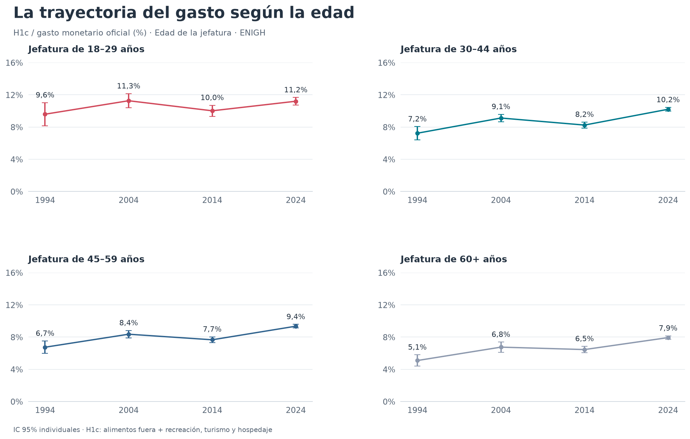
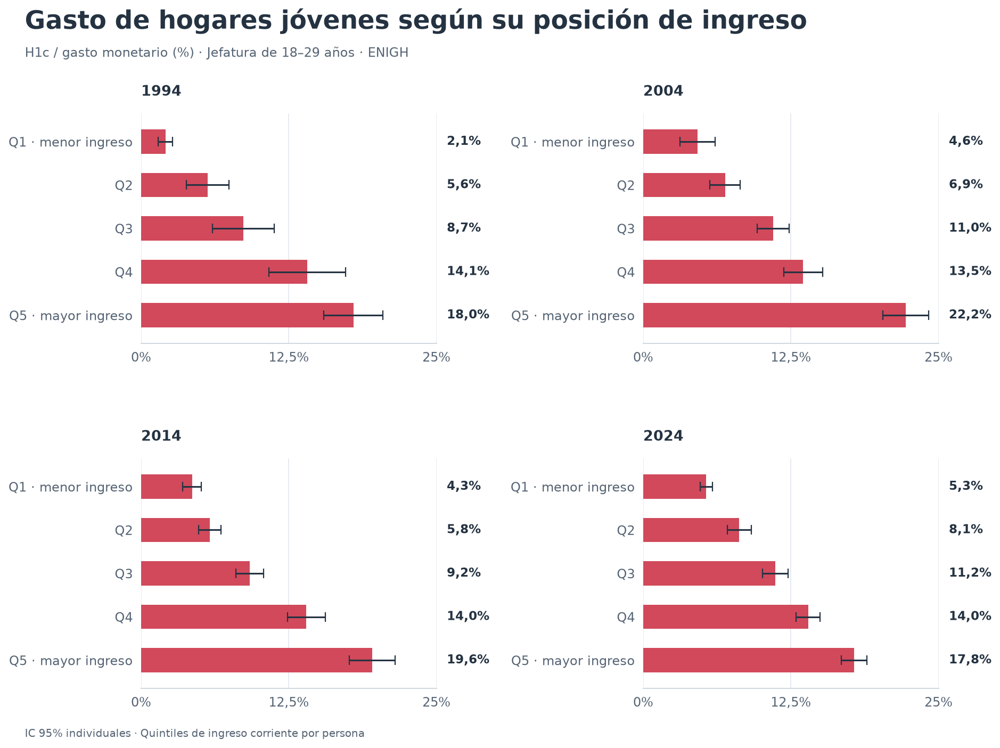

# H1 y comparación histórica del gasto a la misma edad

Los hogares con jefatura de 18–29 años destinan **11.21%** de su gasto monetario a alimentos fuera del hogar y a la categoría amplia de recreación, turismo y hospedaje en 2024. La proporción fue **9.60% en 1994, 11.27% en 2004 y 10.02% en 2014**. La comparación muestra cambios en la composición del gasto y un nivel de 2024 cercano al estimado para 2004.

La [comparación histórica H1–H5](historico_hipotesis.md) amplía este ejercicio con
equipamiento, brechas por decil, movimientos financieros, vivienda, pensiones y
concentración. Conserva H1c para los indicadores de gasto y documenta las diferencias
frente a D2 y a las mediciones de ENSAFI en el [informe completo](historico_hipotesis.html).

## Hipótesis y alcance

**H1 transversal:** en 2024, los hogares con jefatura joven destinan una mayor proporción de su consumo seleccionado a la canasta D2 que los hogares con jefatura de mayor edad. El resultado original se conserva: 17.0% en 18–29 frente a 12.8% en 60+.

**H1c histórica:** a la misma edad de jefatura, la proporción de gasto monetario en alimentos fuera y recreación, turismo y hospedaje es mayor en 2024 que en cada una de las tres olas anteriores. Los contrastes apoyan diferencias positivas respecto de 1994 y 2014, pero el contraste con 2004 es impreciso y cercano a cero. Por tanto, estos resultados no sostienen un aumento frente a todas las épocas comparadas ni un crecimiento continuo.

H1c compara hogares distintos cuya jefatura tiene la misma edad, no a las mismas personas a lo largo del tiempo. El periodo y la cohorte cambian simultáneamente. La categoría incluye comidas por trabajo, computadoras, software y hospedaje no turístico; su aumento no identifica una preferencia por el lujo.

## Resultados principales

Media ponderada de las proporciones de cada hogar. Denominador: gasto corriente monetario oficial, incluidas las transferencias.

| Año | Alimentos fuera | Recreación, turismo y hospedaje | H1c | IC 95% de H1c | Hogares jóvenes válidos |
|---|---:|---:|---:|---:|---:|
| 1994 | 5.88% | 3.71% | 9.60% | 8.17–11.03% | 2,012 |
| 2004 | 7.18% | 4.09% | 11.27% | 10.39–12.15% | 2,780 |
| 2014 | 6.78% | 3.24% | 10.02% | 9.34–10.70% | 2,103 |
| 2024 | 8.03% | 3.18% | 11.21% | 10.74–11.67% | 7,220 |


| Contraste en H1c | Diferencia de 2024, p.p. | IC 95%, p.p. |
|---|---:|---:|
| Frente a 1994 | +1.61 | +0.11 a +3.11 |
| Frente a 2004 | −0.06 | −1.05 a +0.93 |
| Frente a 2014 | +1.19 | +0.36 a +2.01 |

Entre 1994 y 2024, alimentos fuera aumenta **2.15 p.p.**, mientras recreación, turismo y hospedaje disminuye **0.54 p.p.**. Frente a 2004, los cambios son +0.85 y −0.91 p.p., respectivamente. Los intervalos corresponden a cada contraste individual; no tienen ajuste por comparaciones múltiples. Un intervalo que incluye cero no demuestra igualdad.

## Edad e ingreso

Al fijar la distribución de edades simples de 18 a 29 en la observada en 2024, H1c resulta **9.45%, 11.11%, 10.07% y 11.21%**, respectivamente. La diferencia de 2024 frente a 2004 queda en **+0.09 p.p.**, con IC 95% condicional de **−0.90 a +1.08 p.p.**. La lectura general se mantiene al igualar la mezcla de edades.

El grupo 18–29 también oculta diferencias internas:

| Edad de jefatura | 1994 | 2004 | 2014 | 2024 |
|---|---:|---:|---:|---:|
| 18–24 | 11.38% | 13.09% | 9.89% | 11.09% |
| 25–29 | 8.44% | 10.29% | 10.09% | 11.27% |

Los intervalos y tamaños de estos subgrupos están en `h1_historico_perfiles.csv`; las diferencias puntuales de esta tabla no son pruebas de cambio.



Los quintiles se forman en cada ola con ingreso corriente por integrante, entre hogares con jefatura adulta. Permiten comparar posiciones relativas. El mismo quintil en dos años puede representar poderes adquisitivos distintos. Este ejercicio utiliza ingreso por persona, mientras H2 original utiliza ingreso por adulto equivalente.



La composición de los hogares jóvenes también cambia: su tamaño medio pasa de **3.58 a 2.90 integrantes** y el número de menores de 12 de **1.44 a 0.98** entre 1994 y 2024. Los hogares con jefatura joven pasan de **17.22% a 7.40%** del total con jefatura adulta observada. Esta última proporción describe hogares; no es la probabilidad de que una persona joven se emancipe. La estandarización por edad y los quintiles no controlan conjuntamente tamaño familiar, empleo, urbanización ni selección hacia la jefatura.

## Correspondencia entre categorías

| Año | Alimentos fuera | Recreación, turismo y hospedaje |
|---|---|---|
| 1994 | Suma `GAS_TRI`, A204–A207 | E018–E031, L001–L027, N003–N005 |
| 2004 | `FUERA_HOG`, conciliado con A235–A239 | `ESPARCI`, conciliado con E020–E033, L001–L029, N003–N005 |
| 2014 | `ali_fuera`, conciliado con A243–A247 | `esparci + paq_turist`, más gasto monetario N005 |
| 2024 | `ali_fuera`, conciliado con 111111–111116 | `esparci + paq_turist`, más 112012, 112013, 112030 y 112090 |

Las categorías conservan finalidades amplias. Los productos y cuestionarios cambian: por ejemplo, `esparci` de 2024 incluye computadoras y servicios digitales. N005 de 2014 recupera hospedaje no turístico, que las olas antiguas incluían en recreación. Los códigos adicionales de 2024 recuperan hospedaje clasificado en otros gastos y educación, incluido internado escolar. No constituyen una canasta de productos idénticos ni una reconstrucción histórica de D2.

En 2014 y 2024 se suman los componentes monetarios `gasto_tri` de **ambas** tablas de gastos, incluidos pagos monetarios registrados en operaciones mixtas G4/G6. Los campos monetarios vacíos no aportan monto; no se suma `gas_nm_tri`. Limitarse a G1 dejaría fuera copagos que INEGI incluye en sus agregados: en alimentos fuera de 2014 afectaría a 490 hogares. La conciliación exacta de alimentos fuera en 2004, 2014 y 2024, y de recreación en 2004, se publica en la tabla de validación.

También cambia el contenido de alimentos: el capítulo 11 de 2024 usado en D2 incluye alimentos preparados para consumir en casa (111121–111126, como pizza o pollo rostizado), mientras `ali_fuera` incluye únicamente 111111–111116. Por eso el 8.03% histórico de alimentos fuera tampoco sustituye al 11.94% original de restaurantes y hoteles.

El denominador principal es `GASMON`/`gasto_mon`. El resultado de 11.21% no debe compararse directamente con el 17.0% de D2: cambian tanto numerador como denominador y alcance del componente monetario.

La sensibilidad `h1c_sin_transferencias` resta N011–N016 y T901–T904 en 1994; N011–N016 y T901–T914 en 2004; y `transf_gas` en 2014 y 2024. Produce **9.85%, 11.93%, 10.36% y 11.58%**. `transf_gas` de 2024 incluye servicios como comisiones financieras y asistencia, por lo que este denominador neto es una sensibilidad con definiciones propias de cada ola, no un consumo armonizado exacto.

## Universo y precisión

| Año | Hogares de la fuente | Jefatura de 18 o más | Estratos | UPM dentro de estrato |
|---|---:|---:|---:|---:|
| 1994 | 12,815 | 12,508 | 121 | 815 |
| 2004 | 22,595 | 22,565 | 374 | 3,367 |
| 2014 | 19,479 | 19,463 | 200 | 2,626 |
| 2024 | 91,414 | 91,380 | 681 | 10,569 |

Se preservan identificadores como texto y se usan ponderadores de hogar (`HOG`, `factor_hog`, `factor`). Los registros de edad cero de 1994 son 285 y representan 2.44% del peso total de esa fuente; quedan fuera de perfiles por edad, sin imputar su edad. Además se excluyen jefaturas menores de 18 del universo adulto. Los hogares con denominador cero quedan fuera de las medias de participaciones: hay uno en el grupo joven de cada año.

Para cada dominio, la media es `sum(w * participación) / sum(w)`. La influencia de cada hogar válido es `w * (participación − media) / sum(w)`; vale cero fuera del dominio. Se suman influencias por UPM dentro de estrato. La varianza es la suma de `m/(m−1) * sum((U − media(U))²)` por estrato, con todas las UPM de la fuente presentes. Se usa linealización de Taylor y aproximación con reemplazo, sin corrección por población finita. No hay estratos de una sola UPM en estos archivos.

Los IC 95% usan una distribución t con grados de libertad `UPM − estratos`. Para contrastar dos olas se asume independencia, se suman sus varianzas y se utiliza el menor de sus grados de libertad. Los intervalos recogen incertidumbre muestral bajo esa aproximación; los cambios de cuestionario, subreporte y clasificación requieren interpretación adicional.

La estandarización calcula una media por edad simple y las combina con pesos de edad de 2024. Sus intervalos y contrastes tratan esa distribución estimada como fija. Los intervalos por quintil también tratan como fijos los cortes estimados. Son sensibilidades descriptivas condicionales, no ajustes causales completos.

Las participaciones no requieren un deflactor común: dividir numerador y denominador por el mismo índice no cambia el cociente. Esto no elimina cambios de precios relativos ni permite interpretar las participaciones como cantidades físicas. Aquí no se comparan niveles monetarios reales.

## Documentos clave para entender la comparación

Las páginas PDF se cuentan desde la primera hoja del archivo; se indica la numeración impresa cuando difiere.

- **1994:** `Ingreso_Gasto_enigh94.pdf`, páginas PDF **3–4**, dentro del [paquete de construcción de variables](https://www.inegi.org.mx/contenidos/programas/enigh/tradicional/1994/doc/variable94_pdf.zip). Allí están alimentos fuera, recreación y transferencias. El [descriptor](https://www.inegi.org.mx/contenidos/programas/enigh/tradicional/1994/doc/describe94.pdf) identifica `GAS_TRI`, `GASMON`, `HOG`, `EST_DIS` y `UPM`.
- **2004:** [Construcción de variables](https://www.inegi.org.mx/contenidos/programas/enigh/tradicional/2004/doc/variable04.pdf), páginas PDF **5, 7–8**. La separación entre educación, esparcimiento y transferencias explica la correspondencia usada. Lee también la [nota de armonización de ponderadores](https://www.inegi.org.mx/contenidos/programas/enigh/tradicional/2005/doc/armonizada_2005.pdf): la edición descargada usa factores revisados.
- **2014:** [Descripción de la base](https://www.inegi.org.mx/contenidos/productos/prod_serv/contenidos/espanol/bvinegi/productos/nueva_estruc/702825070373.pdf), páginas impresas **155 y 159**, PDF **161 y 165**. Son las construcciones de `ali_fuera`, `esparci`, `paq_turist`, `otros_gas` y `transf_gas`. La página impresa **89**, PDF **95**, define los tipos de gasto. Consulta su [fe de erratas](https://www.inegi.org.mx/contenidos/productos/prod_serv/contenidos/espanol/bvinegi/productos/nueva_estruc/fe_erratas/fe_erratas_702825070373.pdf) junto con el catálogo.
- **2024:** [Descripción de la base](https://www.inegi.org.mx/contenidos/programas/enigh/nc/2024/microdatos/889463924494.pdf), sección **2.4.12**, páginas impresas **293–294**, PDF **299–300**. Muestra cómo INEGI distribuye las nuevas claves entre los agregados tradicionales, incluidos productos digitales, hospedaje y servicios agrupados como transferencias.

## Archivos y reproducción

Desde la raíz del repositorio, con las fuentes descargadas según [data/README](../data/README.md):

```bash
python -m pip install -r requirements.txt
python -m unittest discover -s tests -v
python scripts/compare_history.py
```

El comando escribe ocho CSV `reports/tables/h1_historico_*.csv` y tres PNG `reports/figures/h1_historico_*.png`. `--raw` permite cambiar el directorio de las cuatro olas; `--output` cambia la carpeta de resultados. Se leen las fuentes de nuevo en cada ejecución, sin caché de microdatos.

| Sufijo de tabla | Contenido y unidades |
|---|---|
| `perfiles` | Año × edad × indicador; proporción, error estándar, IC 95%, n válido y hogares expandidos |
| `cambios` | Diferencias 2024 menos cada ola anterior, en puntos porcentuales, con error estándar e IC |
| `edades_ajustadas` | Participaciones con pesos de edades simples de 2024 |
| `pesos_edad` | Distribución de edades que se mantiene fija en la estandarización |
| `quintiles` | H1c de jóvenes por quintil de ingreso corriente por persona de cada año |
| `composicion` | Edad, integrantes, menores de 12, ocupados y proporción de hogares jóvenes |
| `correspondencias` | Variables, claves y decisiones de alcance por ola |
| `validacion` | Conteos de fuente, exclusiones, diseño y errores de conciliación en pesos nominales de cada ola |

Las proporciones en CSV están en escala 0–1; las columnas terminadas en `_pp` están multiplicadas por 100. Edad, integrantes y ocupados están en sus unidades naturales. Los archivos publicables contienen únicamente resultados agregados. El [manifiesto de descarga](../data/enigh_downloads.csv) conserva las ediciones y huellas SHA-256 de las fuentes.
