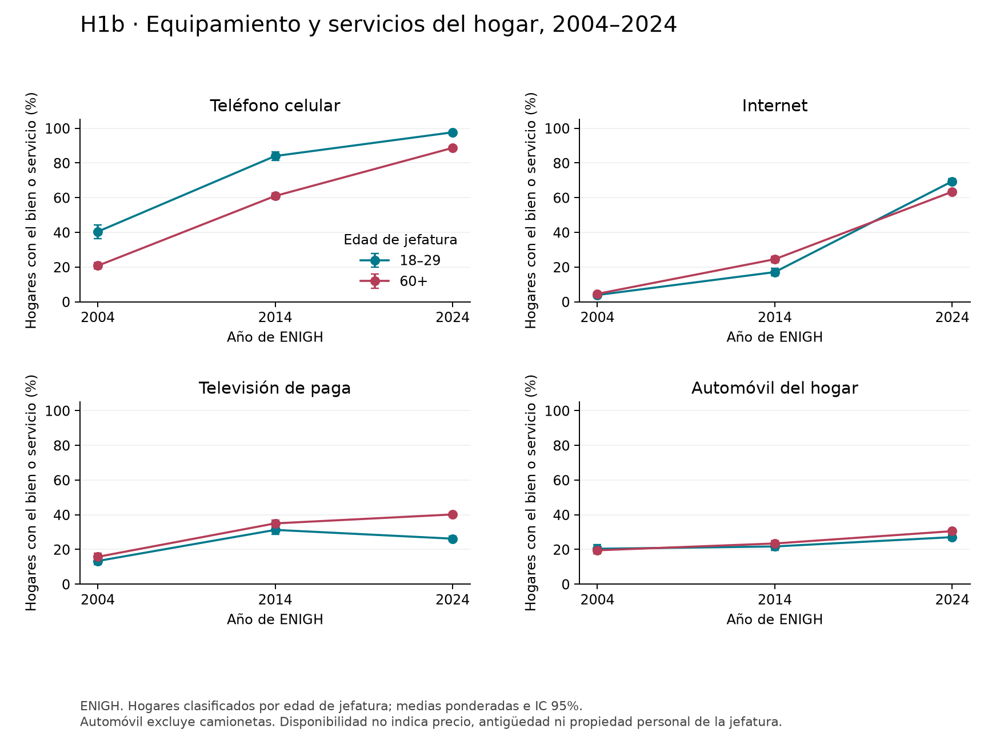
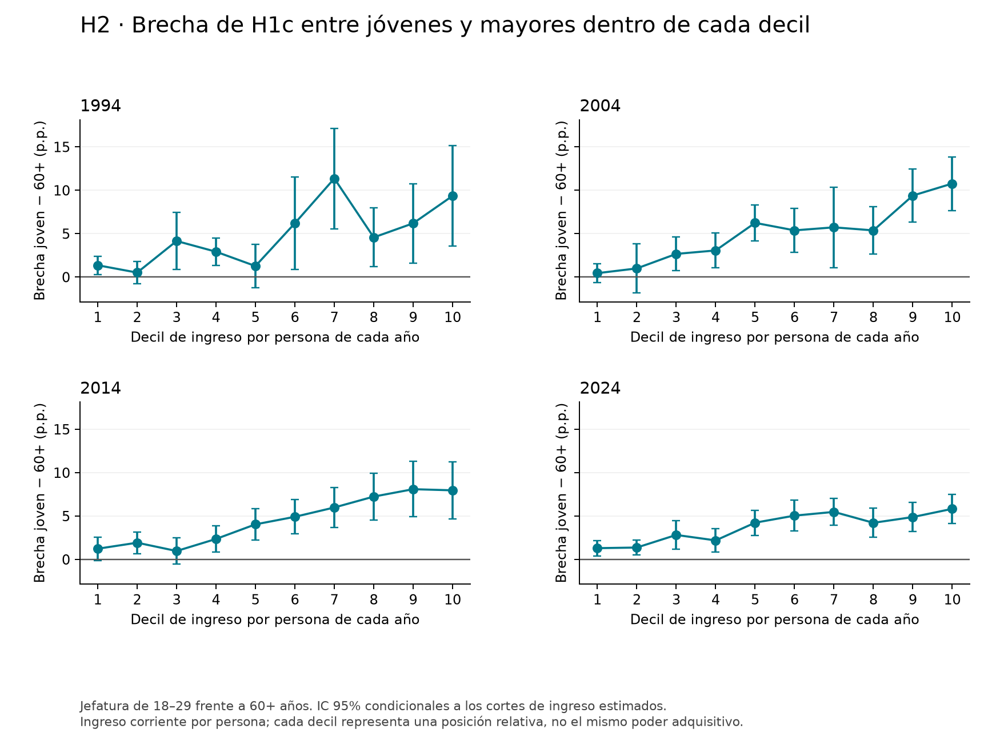
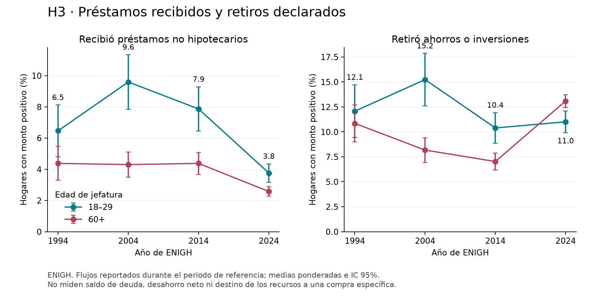
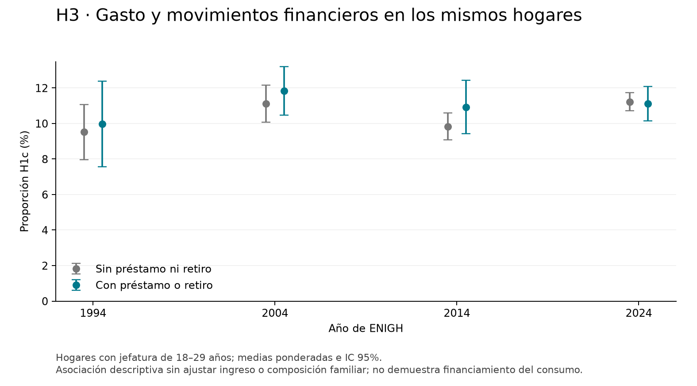
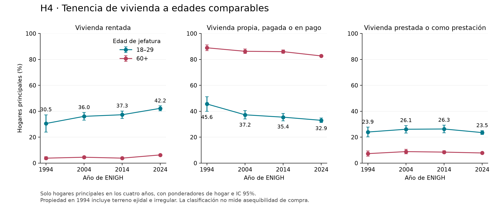
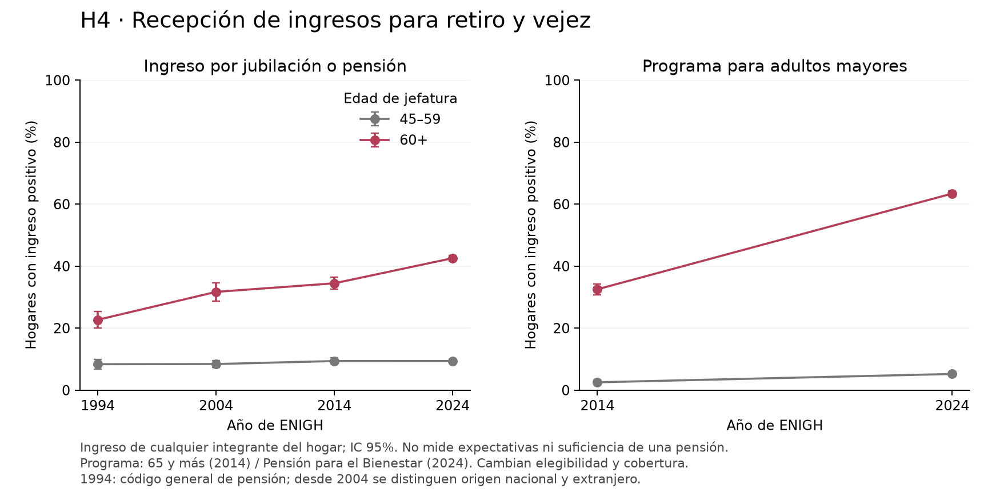
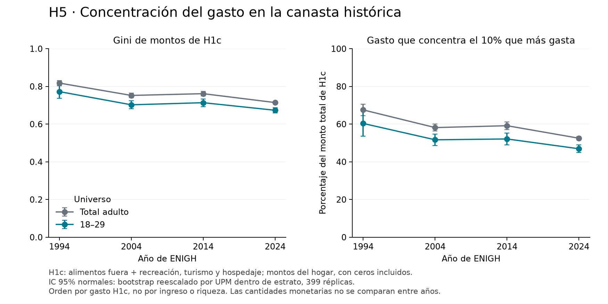

# Comparación histórica de H1–H5

ENIGH 1994, 2004, 2014 y 2024. [Informe completo](historico_hipotesis.html),
[resumen numérico](tables/historico_resumen.csv) y [correspondencias de variables](tables/historico_correspondencias.csv).

Las extensiones de gasto usan H1c (alimentos fuera más recreación, turismo y hospedaje),
con una definición distinta de D2. H3 mide movimientos financieros; H4 distingue
tenencia, pensiones recibidas y programas para adultos mayores. El informe explica
los universos, intervalos, cambios de clasificación y límites de cada comparación.

## H1. Gasto a la misma edad


## H1b. Equipamiento y servicios del hogar



## H2. Brechas dentro de cada decil de ingreso



## H3. Movimientos financieros y gasto





## H4. Vivienda y recepción de ingresos para la vejez





## H5. Concentración del gasto



## Tablas

| Archivo | Contenido |
|---|---|
| [historico_resumen.csv](tables/historico_resumen.csv) | Comparación principal, en porcentajes. |
| [historico_perfiles.csv](tables/historico_perfiles.csv) | 312 estimaciones por edad, indicador y año, con IC y tamaños muestrales. |
| [h2_historico_brechas.csv](tables/h2_historico_brechas.csv) | 40 diferencias joven menos 60+ dentro de deciles de ingreso por persona. |
| [h3_historico_asociacion.csv](tables/h3_historico_asociacion.csv) | H1c según préstamos/retiros y sus contrastes. |
| [h4_historico_carga_renta.csv](tables/h4_historico_carga_renta.csv) | Medianas de renta/ingreso de 2014 y 2024, sin IC. |
| [h5_historico_concentracion.csv](tables/h5_historico_concentracion.csv) | Gini, top 10%, top 20% e IC por bootstrap de UPM. |
| [historico_edades_ajustadas.csv](tables/historico_edades_ajustadas.csv) | Sensibilidades con distribución de edades de 2024. |
| [historico_contrastes.csv](tables/historico_contrastes.csv) | Diferencias de 2024 frente a cada año anterior, en puntos porcentuales. |
| [historico_correspondencias.csv](tables/historico_correspondencias.csv) | Claves históricas de préstamos, retiros, pensiones y vivienda. |
| [historico_validacion.csv](tables/historico_validacion.csv) | Conciliaciones y discrepancia conocida del agregado JUBILA 2004. |

Excepto historico_resumen.csv y los campos terminados en `_pp` de historico_contrastes.csv, las proporciones
y sus intervalos usan escala 0–1. `n` cuenta observaciones muestrales;
`hogares_expandidos` suma los ponderadores. Los archivos son agregados sin identificadores.
[historico_metodologia.json](historico_metodologia.json) registra las claves y hashes de las fuentes adicionales;
sus rutas son relativas al directorio de microdatos ENIGH indicado con `--raw`.

## Reproducción

Desde la raíz del proyecto, con las dependencias y las fuentes de [data/README.md](../data/README.md):

```bash
python scripts/compare_all_history.py
# Directorios alternativos:
python scripts/compare_all_history.py --raw /ruta/enigh --output /ruta/resultados
```

El comando reconstruye los diez CSV en `reports/tables/`, los ocho PNG en `reports/figures/`,
el registro de fuentes y el informe HTML en `reports/`.
Lee los microdatos de nuevo; no guarda copias ni cachés individuales en esta carpeta.
